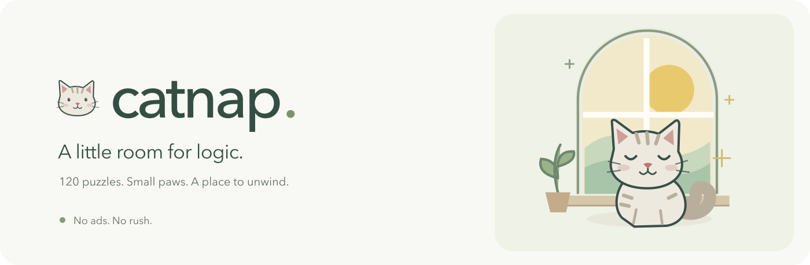
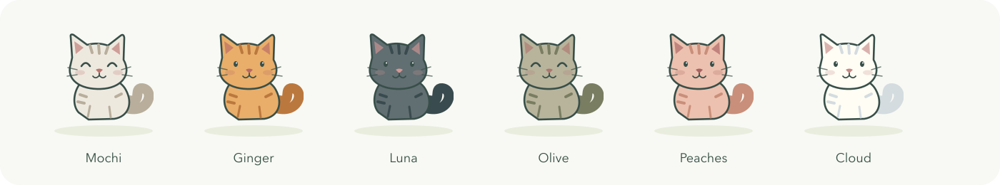

# Catnap

A cozy cat logic game for your browser. Find a home for every cat, follow a winding chapter map, and enjoy a little company along the way.

**No ads, sound, vibration, or music. Just you and the puzzle.**

## A little puzzle, a little progress

- **120 puzzles** from 5×5 to 9×9, plus a daily puzzle.
- **A winding journey** with stars, chapter gifts, and new cat companions.
- **Useful rewards:** earn hints and “Find a cat” assists, with free refills when you run out.
- **Simple controls:** single tap for an X, double tap for a cat. Each cat matches its region.
- **Pick up where you left off:** automatic local saves, offline play, and save-file transfers between devices.
- **Made for Mac and iPhone**, with keyboard controls and reduced-motion support.

Place one cat in every row, column, and colored region. Cats cannot touch—even diagonally. Take your time; there are no lives to lose.



## Try it locally

Requires Node.js 24.

```sh
npm ci
npm run dev
```

Built with React, TypeScript, Vite, Motion, and Dexie. No account or backend needed. Progress stays in each browser; use export/import to move it between devices.

[Deploy to GitHub Pages](docs/development.md#deploy-to-github-pages) · [Development guide](docs/development.md) · [Image suggestions](docs/images/README.md)
